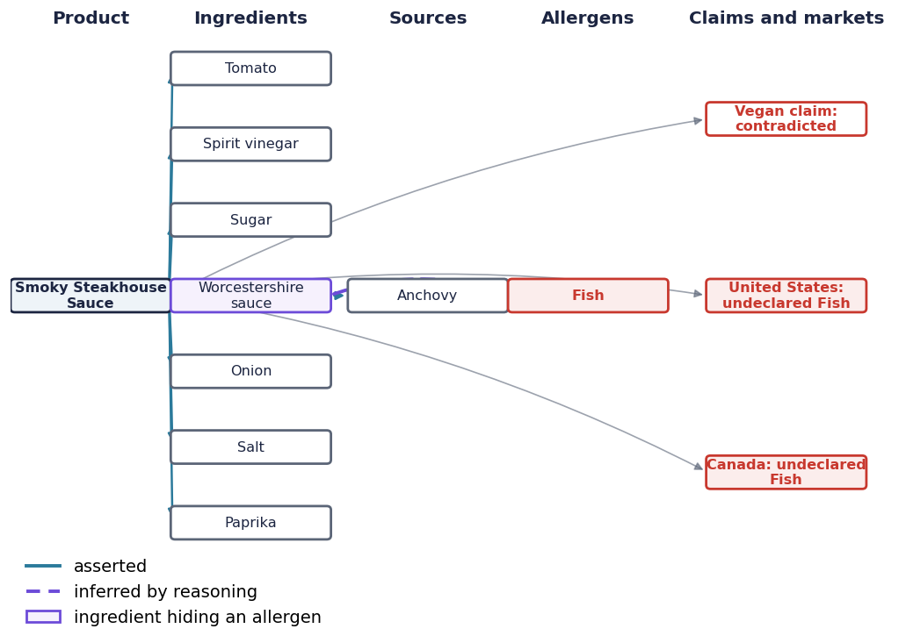
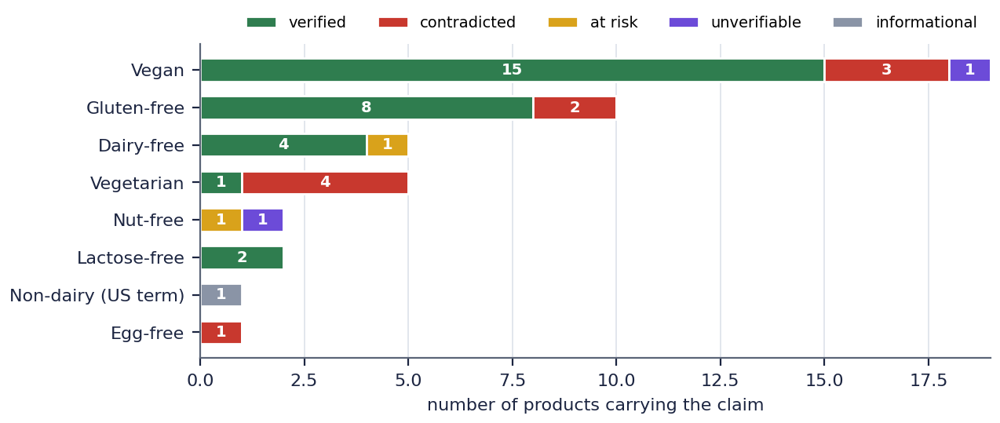
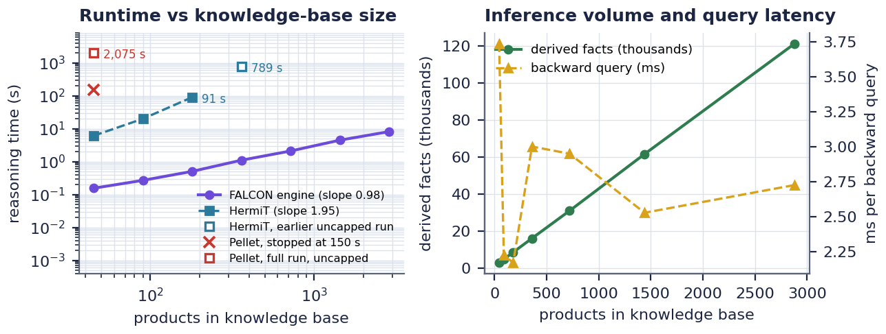
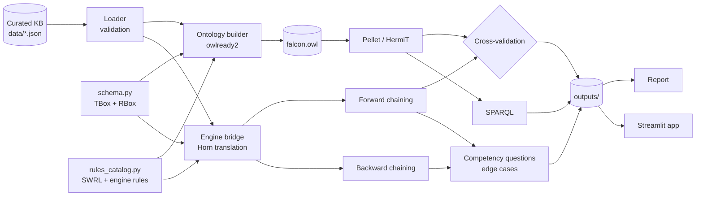

# FALCON: a knowledge graph that reads food labels the way a regulator would

Paste an ingredient list. FALCON follows every ingredient back to its source, checks every claim printed on the pack, and works out which market would reject the product. Every verdict comes with a proof.

<p align="center"></p>

The sauce above is labelled vegan. Nothing on its label says fish, yet the reasoner follows Worcestershire sauce to its anchovy component. It concludes that the claim is false, and that both the US and Canada would require fish to be declared.

**[Live app](https://falcon-allergen-reasoner.streamlit.app/)** · **[Technical report (PDF)](docs/FALCON_Technical_Report.pdf)** · **[Executed notebook with all outputs](notebooks/FALCON_Notebook_executed.ipynb)**

## Why food labels are a reasoning problem

- **Allergens hide inside other ingredients.** Caseinate in a "non-dairy" whitener is milk protein. Tahini is sesame. The lysozyme in some hard cheeses comes from egg white.
- **Claims don't mean what shoppers assume.** "Lactose-free" says nothing about milk allergy, "gluten-free" is not wheat-free, and "non-dairy" is a US legal term that permits milk protein.
- **The law changes at the border.** Pine nuts are a declarable tree nut in the US and Canada but not in the EU. Mustard, celery and lupin are EU-regulated. At exactly 10 mg/kg of sulphites a product needs a declaration in North America (10 ppm or more) but not in Europe (more than 10 mg/kg).

## What it found in a 45-product test portfolio

| Finding | Result |
|---|---|
| Label claims contradicted by the product's own recipe | 10 of 45 |
| Undeclared allergen obligations | 17, in 10 products |
| Allergens hidden inside other ingredients | 10 |
| Product–allergen pairs that US, Canadian and EU law treat differently | 11 |
| False "safe" or "vegan" verdicts a naive closed-world system would have given | 23 (FALCON: 0) |
| Precision and recall of keyword screening, scored against the ontology | 0.82 |

The portfolio is curated: every product exists to test a specific question or edge case. These numbers show what the method can detect, not how often problems occur in shops.

<p align="center"></p>

## Two reasoners, one answer

The same rules run in the Pellet OWL reasoner and in FALCON's own engine, and their conclusions are compared fact by fact.

| | Pellet (OWL 2 DL + 17 SWRL rules) | HermiT (13 rules without built-ins) | FALCON engine |
|---|---|---|---|
| Ontology consistent | yes | yes | — |
| Facts compared with the engine | 888 of 888 agree, across 47 predicates | — | — |
| Time on the 45-product knowledge base | 34.6 min | 5.8 s | 0.13 s |

Pellet takes 25 to 36 minutes for every complete run, yet it finds an injected contradiction in under a second. HermiT's time grows about quadratically with the number of products (exponent 1.945), while the engine's grows linearly. Results come from one complete run on Google Colab with Python 3.13, owlready2 0.51 and Java 25.

<p align="center"></p>

## What's inside

- **OWL 2 DL ontology (SROIQ(D))**, generated with owlready2. It has 92 classes (62 named, 30 defined), 33 properties, 4 property chains, 3 general class axioms, cardinality and disjointness axioms, and 262 individuals. It opens in Protégé.
- **17 SWRL production rules**, executed by Pellet, with HermiT checking consistency.
- **A purpose-built rule engine** (pure Python, Datalog with stratified negation). It runs the same SWRL rules plus 49 more that OWL can't express: negation as failure, three-way relations and defeasible exemptions.
  - Forward chaining is semi-naive and keeps full provenance.
  - Backward chaining produces proof trees and *why not* explanations.
- **Local closed-world reasoning.** Closed-world conclusions are drawn only for records marked complete, so missing data never becomes a false "safe".
- **Cross-validation.** Pellet's conclusions are compared fact by fact with the engine's.
- **14 competency questions**, each with a SPARQL version.
- **8 edge-case experiments:** open vs closed world, conflicting claims, injected data errors, ambiguous sources, exemptions, a numeric boundary and lexical traps.
- **Scalability benchmark.** Engine runtime grows linearly, reaching 2,880 products and 121,293 inferred facts in 8.2 s on Colab. Each OWL reasoner run is capped at 150 s.
- **Streamlit app** with a *Label X-ray* and a *Myth or fact?* game (see below).
- **Technical report** in APA style, [docs/FALCON_Technical_Report.pdf](docs/FALCON_Technical_Report.pdf). It's generated from the run outputs, so its numbers can't drift from the code.
- **31 automated tests**, plus CI that runs the full Pellet/HermiT pipeline on every push.

## The app

```bash
streamlit run app/streamlit_app.py
```

- **Label X-ray.** The opening screen is an ingredient panel for a real-looking product. Switch on *X-ray the label* and the reasoner reveals what the label hides: inferred allergens, false claims, and the markets that would reject it.
- **Check a label.** Paste any ingredient list, pick claims and markets, and get allergens, claim verdicts, per-market declaration duties and a verdict for each of 9 consumer profiles. Click any conclusion to see its proof in plain English and as a proof tree, or replay the forward-chaining run step by step. Ingredients the ontology doesn't know make the record incomplete, so nothing gets confirmed safe on a guess.
- **Myth or fact?** Twelve things people believe about labels. Make your call; the reasoner then proves or refutes each answer from the knowledge base, with no lookup table involved.
- **Also included:** product knowledge graphs, an ontology sunburst, a compliance atlas (market heatmap, ingredient-to-allergen-to-market Sankey diagram, consumer safety matrix), a reasoning lab for asking any goal, all 14 competency questions, and the edge cases.

The app reasons live with the pure-Python engine, so it needs no Java. To deploy it free on [Streamlit Community Cloud](https://streamlit.io/cloud), point it at this repository with `app/streamlit_app.py` as the main file.

## Quick start

**Windows (PowerShell)**

```powershell
Set-ExecutionPolicy -Scope Process -ExecutionPolicy Bypass
.\setup_windows.ps1                       # venv + packages; installs Java 25 via winget if missing or older
.\.venv\Scripts\Activate.ps1
python -m unittest discover -s tests -t . -v
python run_all.py                          # engine + Pellet + HermiT, writes outputs/
streamlit run app/streamlit_app.py
```

**macOS / Linux**

```bash
python3 -m venv .venv && source .venv/bin/activate
pip install -r requirements.txt            # Java 25+ for Pellet (owlready2 0.51+); HermiT also runs on older Java
python check_environment.py && python run_all.py
```

**Notebook walk-through:** [notebooks/FALCON_Notebook.ipynb](notebooks/FALCON_Notebook.ipynb) demonstrates the whole system with narrative, code, traces and figures. The code is embedded, so it runs in Google Colab with *Runtime > Run all*. A full run takes about 4.5 hours, almost all of it in Pellet, so [notebooks/FALCON_Notebook_executed.ipynb](notebooks/FALCON_Notebook_executed.ipynb) keeps a complete run with every output. Alternatively, push to GitHub and the Actions workflow runs everything, publishing `outputs/` as a downloadable artifact.

`python run_all.py --engine-only` skips the Java reasoners.

## Architecture



**Design decisions that matter**

- *One schema, two reasoners.* `falcon/schema.py` is the single source of truth: it builds the OWL ontology and, through a Horn translation, the engine's rule base. Disagreement between them is a bug the cross-validation catches.
- *Ingredient kinds are individuals*, because SWRL rules can only bind named individuals.
- *Provenance and allergen retention are separate properties.* `retainsAllergensOf` is a sub-property of `derivedFrom`, so refined soybean oil is made from soy without carrying soy allergen. No exception rule is needed.
- *Gluten is a hazard separate from wheat*, so a gluten-free loaf made with Codex wheat starch is safe for a coeliac but not for someone with a wheat allergy.
- *Claims are data, not axioms.* One false claim is reported instead of making the whole ontology inconsistent.
- *Market-specific membership lists* instead of a global "tree nut" class, because the markets disagree.

## Project structure

```
falcon_kr/
├── app/streamlit_app.py      Label X-ray app
├── data/                     curated knowledge base (JSON)
├── docs/                     technical report (PDF) and figures
├── falcon/
│   ├── schema.py             classes, properties, axioms
│   ├── rules_catalog.py      SWRL, engine and integrity rules
│   ├── rule_engine.py        forward/backward chaining with proofs
│   ├── ontology_builder.py   owlready2 ontology
│   ├── owl_reasoning.py      HermiT, Pellet, SPARQL, cross-validation
│   ├── competency.py         14 competency questions
│   ├── edge_cases.py         8 experiments
│   ├── benchmark.py          scalability
│   ├── viz.py                figures
│   └── app_logic.py          app logic (testable, no Streamlit)
├── notebooks/                full narrated notebook (runs in Colab)
├── report/                   report generator (Python + docx-js)
├── tests/                    31 tests
├── run_all.py                one command for everything
└── .github/workflows/        CI: tests + full reasoning on every push
```

## Tech stack

Python, OWL 2, SWRL, SPARQL, owlready2, HermiT, Pellet, a custom Datalog engine, matplotlib, Plotly, Streamlit, docx-js and GitHub Actions.

## Roadmap

- Load real products from an open food database and measure how often these problems actually occur.
- Align ingredient classes with FoodOn (MIREOT) and add SHACL validation at data entry.
- Model cross-contact risk explicitly.
- Add knowledge-graph embeddings (pykg2vec, with Bayesian hyperparameter tuning) as a triage tool that ranks products for review, alongside the proofs rather than instead of them.

## Sources and acknowledgements

Regulatory facts come from FDA guidance (2025), 21 CFR 101.4 and 101.100, Health Canada's allergen labelling regulations, and Regulation (EU) No 1169/2011, Annex II. The full reference list is in the report. Claude (Anthropic) assisted with design discussions, code drafting, debugging and editing; all sources and results were checked independently.

*FALCON demonstrates a method on a curated knowledge base. It is not a substitute for reading the actual label or for professional advice.*
